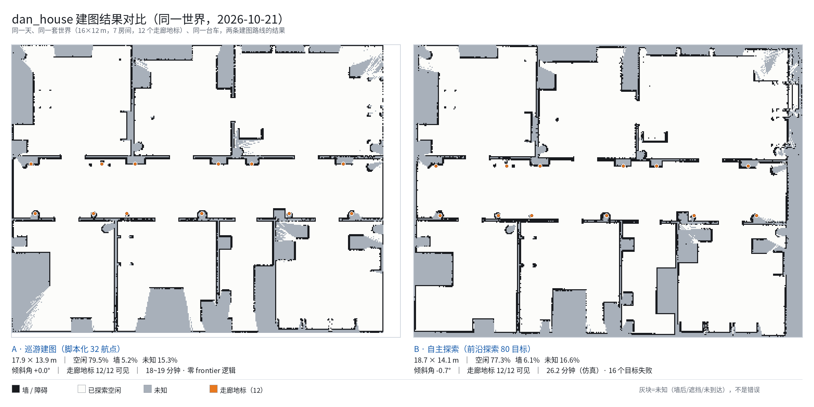

# dan_house —— 7 房间 / 16x12 m SLAM + Nav2 练习手册

> 目标：一台 **Lighthouse（灯塔）** 差速小车 —— 底盘血统是 TurtleBot3 Waffle，但在一个 7 房间的公寓里
> **自己建图（slam_toolbox）→ 存图 → 自主导航（Nav2）**。
> 本文是"你自己敲命令"的剧本，每个阶段都有"怎么验证这一步对了"。

---

## 两条路线怎么选（结论先看这里）

本工程有两条并存的建图路线，**都跑通、都能出图**，最终质量打平。
数据来自 2026-10-21 在同一套世界（含 12 个走廊地标）上的实测：

| 指标 | A · 巡游建图（脚本化航点） | B · 自主探索（前沿探索） |
|---|---|---|
| 命令 | `... tour:=true tour_speed:=0.15` | `... explore:=true ekf:=true` |
| 输入 | `config/route.json`，**32 个手标航点** | 无，自己找 frontier |
| 用时 | 18~19 分钟（实际时间） | 26.2 分钟（仿真时间，实际约 45~60 分） |
| 目标数 | 32 个航点**全部走完** | 80 个目标，16 个失败（20%） |
| 地图尺寸 | 17.9 x 13.9 m | 18.7 x 14.1 m |
| 空闲 / 墙 / 未知 | **79.5%** / 5.2% / 15.3% | 77.3% / 6.1% / 16.6% |
| 倾斜角 | +0.0° | -0.7° |
| 走廊地标可见 | 12/12 | 12/12 |
| 墙线质量 | 单线、门洞清楚、无重影 | 同左（局部噪声略多） |
| 换布局要做什么 | **重新标定 32 个航点** | **什么都不用改** |



*左：A 巡游建图（32 手标航点）｜右：B 自主探索（80 目标）。橙点 = 12 个走廊地标，两侧都可见；
灰块是未知区（墙后/遮挡/未到达），不是错误。*

> 这张图由 `tools/map_compare.py` 生成，数字是现算的（和 `tools/map_quality.py` 同一套算法），
> 换了地图重跑一次即可：
> `/usr/bin/python3 tools/map_compare.py config/maps/A.pgm config/maps/B.pgm docs/map_compare.png`

**结论：**

- **要一张稳定、可复现、可交付的参考图 → 选 A（巡游）**。它确定、快、零失败，
  适合作为导航用的"标准地图"（当前 `config/maps/dan_house.pgm` 就是它）。
- **要证明系统会自己探、以后换布局不用人工介入 → 选 B（探索）**。覆盖率已经和
  人工标定航点打平（77.3% vs 79.5%），倾斜角也在 1° 内，代价是时间多一倍多。
- 两者的**共同前提**是一样的，缺一个两条路都会画歪（详见第 16 节）：
  ① 里程计可信（A 真值 / C 用 EKF 融合轮式 vx + 陀螺 vyaw）；
  ② 走廊必须有穿过雷达平面（0.132 m）的地标，否则扫描匹配在走廊方向退化；
  ③ 雷达 `max_laser_range` 必须与 `model.sdf` 的 12 m 一致。

```bash
# A · 巡游（当前主要出图方式）
ros2 launch ./dan_house.launch.py headless:=true slam:=true tour:=true \
    tour_speed:=0.15 tour_spin_rate:=0.3 rviz:=true

# B · 自主探索（零输入，自己把可达区域探完）
ros2 launch ./dan_house.launch.py headless:=true explore:=true ekf:=true rviz:=true \
    explore_max_minutes:=40 explore_max_goals:=80
```

存档：巡游图 `config/maps/preserved/dan_house_with_landmarks_2026-10-21_1529.*`，
探索图 `config/maps/preserved/dan_house_explore_FINAL_2026-10-21_1800.*`。

> **换雷达**：以上全部是**单线**雷达版本（默认 `lidar:=2d`）。要跑 64 线版本
> （低矮家具也能进图/进代价地图）加一个 `lidar:=3d` 即可，两种版本共用同一套 launch、
> 同一套 Nav2 参数、同一套智能体代码。详见 **第 17 节**。

> 探索这条路走过的弯路（供后人少踩）：30 个目标时倾斜 39°（odom 不可信）→
> 加走廊地标前有重影（18.3x17.6 m）→ 目标贴墙导致原地打转 20 分钟 →
> 18 秒烧光 18 个配额（目标落在容差内）→ 187 秒/目标（目标朝向写死 yaw=0）。
> 详细数据与修法见**第 15、16 节**。

---

## 0. 目录结构（改完之后）

```
robot/
├── build_world.py                 # 参数化生成世界（改房间/家具改这里，然后重跑）
├── worlds/dan_house.world         # 生成物（不要手改，会被覆盖）
├── worlds/textures/*.jpg          # PBR 贴图
├── gen_textures.py                # 贴图生成器（贴图丢了可以重跑）
├── models/turtlebot3_waffle/model.sdf   # 新机器人：官方 STL 网格 + gz-sim 插件
├── dan_house.launch.py            # 唯一入口：仿真 + TF + 可选 SLAM / Nav2 / RViz
├── odom_tf_node.py                # /odom -> TF(odom->base_footprint)
├── config/slam_toolbox.yaml       # 建图参数
├── config/nav2_params.yaml        # Nav2 参数（AMCL/规划/控制/代价地图）
├── config/maps/                   # 存图目录（dan_house.pgm + .yaml）
└── rviz/dan_house.rviz            # 预配置 RViz（Fixed Frame = map）
```

### 可以删的多余文件（你自己敲，我不替你删）

```bash
cd /home/dan/HelloAgents/hello-agents/code/chapter6/AutoGenDemo/robot
rm -f  dan_house.launch.py_OLD      # 旧的 launch，已被新文件取代
rm -f  fix_materials.py             # 一次性修补脚本，早已应用完毕
rm -f  save_map_from_getmap.py      # 手搓存图脚本，改用官方 map_saver_cli
rm -rf __pycache__
rm -rf map_capture                  # 空 rosbag（0 条消息）
rm -rf models/dan_bot               # 旧的黄方块机器人，已被 turtlebot3_waffle 取代
```

删除前想留备份：`cp -r . ~/robot_backup_$(date +%F)`

---

## 1. 环境铁律（踩过的坑）

| 规则 | 原因 |
|---|---|
| 每开一个新终端先 `source /opt/ros/humble/setup.bash` | 否则找不到包 |
| **不要在 `.venv` / conda 环境里跑 launch** | rclpy 是给系统 python3.10 编译的，会报 `No module named 'rclpy._rclpy_pybind11'` |
| 结束用 **Ctrl+C**，不要 `pkill -f dan_house.launch.py` | pkill 只杀 launch 进程，gz / 桥 / 节点会变孤儿进程 |
| 这台机器命令行是 `ign gazebo`（不是 `gz sim`） | gz-tools 6 对应 Ignition Fortress，`gz sim` 是 Garden+ 的写法 |
| 万一有残留：`ps aux \| grep -E "ign gazebo\|odom_tf_node"` 再 `kill <pid>` | 不清干净会同时跑两个仿真 |

`grep` 自己进程的小技巧：`pkill -f "[d]an_house"`（方括号让模式不匹配自己）。

---

## 2. 阶段一：先确认世界/机器人/传感器没问题（不建图）

```bash
cd /home/dan/HelloAgents/hello-agents/code/chapter6/AutoGenDemo/robot
source /opt/ros/humble/setup.bash
ros2 launch ./dan_house.launch.py rviz:=true
```

新开一个终端验证（这套检查以后每次改世界都跑一遍）：

```bash
source /opt/ros/humble/setup.bash

# 1) 雷达有没有数？frame 必须是 base_scan
ros2 topic hz /scan                      # 应该 ~10 Hz
ros2 topic echo /scan --once --field header   # frame_id: base_scan

# 2) 里程计在动吗？
ros2 topic echo /odom --once --field pose.pose.position

# 3) TF 链是否闭合（SLAM 的命门）
ros2 run tf2_ros tf2_echo odom base_scan
ros2 run tf2_tools view_frames           # 生成 frames.pdf，看一眼树

# 4) 键盘遥控（注意要选中终端，按 i 前进）
ros2 run teleop_twist_keyboard teleop_twist_keyboard
```

期望的 TF 树（少一条 SLAM 就报 "no transform"）：

```
map -> odom -> base_footprint -> base_link -> base_scan
                                          -> imu_link
                                          -> camera_link -> camera_rgb_optical_frame
```

看到的东西应该是：
- 车是**黑色/深灰三层板的 TB3 Waffle**（有轮子、有激光雷达、有摄像头），不再是黄方块
- 车在**走廊正中间 (0,0)**，四周 7 个房间 + 长 15.8 m 的走廊
- 房间净尺寸 ≥ 2.4 x 4.7 m，门洞 1.0 m，走廊净宽 2.08 m

---

## 3. 阶段二：手动建图（slam_toolbox）

```bash
ros2 launch ./dan_house.launch.py slam:=true rviz:=true
```

另开终端手动开：

```bash
source /opt/ros/humble/setup.bash
ros2 run teleop_twist_keyboard teleop_twist_keyboard
```

**走法建议**（保证建图质量）：

1. 沿走廊从头走到尾，再走回来（形成回环，看 slam_toolbox 闭合）
2. 每个门洞**探进去**，把房间绕一圈（不要只站在门口看）
3. 速度慢一点：`teleop` 里按几下 `q/z` 把速度降到 0.15 m/s 左右
4. 转角时慢，别让车头贴着墙角打转（建图会糊）

一边走一边看图：

```bash
ros2 topic hz /map                       # 地图刷新
ros2 topic echo /map_metadata --once     # width/height 在长大 = 正在建图
# RViz 里把 Map 勾上，能看到灰色未知区域被白色/黑色填满
```

如果不放心 TF 时间戳：`ros2 run tf2_tools view_frames` 检查有没有 `map -> odom`。

---

## 4. 阶段三：存图

建完图**先别 Ctrl+C**，另开终端：

```bash
cd /home/dan/HelloAgents/hello-agents/code/chapter6/AutoGenDemo/robot
source /opt/ros/humble/setup.bash
ros2 run nav2_map_server map_saver_cli -f config/maps/dan_house
```

成功输出 `Map saved`，得到 `config/maps/dan_house.pgm` + `.yaml`。

> ⚠️ 我验证时留了一张**只覆盖走廊一部分**的 `dan_house.{pgm,yaml}`（用于跑通 Nav2 链路）。
> 你按阶段二重新建完图再存一次，直接覆盖它就行。

检查生成结果：

```bash
cat config/maps/dan_house.yaml     # resolution 0.05, origin 是左下角
```

---

## 5. 阶段四：Nav2 自主导航

```bash
ros2 launch ./dan_house.launch.py nav:=true rviz:=true
```

检查 Nav2 是否全部激活（每个都应该是 `active [3]`）：

```bash
for n in map_server amcl planner_server controller_server bt_navigator behavior_server; do
  echo -n "$n: "; ros2 lifecycle get /$n
done
```

命令行发一个目标点（等价于 RViz 里点 "2D Goal Pose"）：

```bash
ros2 action send_goal /navigate_to_pose nav2_msgs/action/NavigateToPose \
"{pose: {header: {frame_id: map}, pose: {position: {x: 3.0, y: 0.0}, orientation: {w: 1.0}}}}" --feedback
```

或者在 RViz 里：
1. 工具 **2D Pose Estimate** — 给 AMCL 初始位姿（本配置已自动给 (0,0,0)，方向不对时用它纠正）
2. 工具 **2D Goal Pose** — 点目标位置，拖一下定朝向
3. 看 **Global Plan（绿线）/ Local Plan（橙线）**，AMCL 粒子云应收敛成一个点

导航中常用诊断：

```bash
ros2 topic hz /cmd_vel                    # 控制器在发速度
ros2 topic echo /plan --once --field header   # 规划路径
ros2 param get /local_costmap/local_costmap robot_radius
ros2 service call /navigate_to_pose/_action/cancel_goal ...   # 取消（或 RViz 里直接发新目标）
```

---

## 6. 想重新设计房子？改 build_world.py，不要手改 world

```bash
python3 build_world.py            # 重新生成 worlds/dan_house.world
ign sdf -k worlds/dan_house.world # 语法校验，必须输出 Valid
```

改房子的三处入口（文件顶部都有注释）：

1. **全局尺寸**：`XW/XE/YS/YN`（外墙中心线）、`COR`（走廊墙位置）、`H`（层高）
2. **房间表 `ROOMS`**：每个房间的净尺寸 + 地板材质；改墙要同步改这里的 `x0/x1/y0/y1`
3. **门洞**：`hwall(... doors=[(门中心, 门宽)])` / `vwall(...)`，改完记得**留 1.3 m 净空**

家具是函数式的（`sofa(cx, cy, rz)` 之类），坐标全在"按房间摆放家具"那一段，注释里标了每个房间的净尺寸范围和门位置。

想加第 8 个房间：在 `ROOMS` 里加一行矩形 + 在对应 `vwall` 里加一道隔墙 + 在走廊墙上开一个 `doors=[(x, 1.0)]`。

---

## 7. 我实际验证过的（不是"应该能跑"）

| 项目 | 结果 |
|---|---|
| `ign sdf -k worlds/dan_house.world` | **Valid**（122 个静态模型，250 处 PBR 贴图） |
| gz server 加载世界 + 生成模型 | 通过（`Serving entity system service`） |
| `/scan` header.frame_id | `base_scan`（靠 SDF 的 `<gz_frame_id>`，无 hack） |
| TF `map -> base_scan` | 解析成功，平移 `(-0.064, 0, 0.132)` = 官方 URDF 的雷达位 |
| 差速驱动 | `cmd_vel 0.2` × 4 s → odom x 前进 0.77 m |
| slam_toolbox 建图 | `/map` 316×168 格（15.8×8.4 m）并持续增长 |
| `map_saver_cli` 存图 | `Map saved successfully` |
| Nav2 六个节点 | 全部 `active [3]` |
| 端到端导航 | 目标 (3.0, 0.0) → `Reached the goal!` / `Goal succeeded` |

未验证（需要 GUI，你在本机跑一眼）：Gazebo GUI 外观、RViz 里 `rviz/dan_house.rviz` 的显示效果。

---

## 8. 关键尺寸速查

| 项 | 值 |
|---|---|
| 房子外框 | **18.0 x 14.0 m** |
| 层高 / 门洞高 | **2.7 m / 2.1 m** |
| 走廊净宽 | **2.88 m**（全长 17.8 m） |
| 门洞宽 | **1.3 m**（卫生间 1.2 m） |
| 房间净尺寸 | 客厅 5.69x5.33 / 厨房 4.68x5.33 / 书房 7.17x5.33 / 卧室1 4.89x5.33 / 卧室2 4.78x5.33 / 卫生间 2.58x5.33 / 储藏 5.17x5.33 |
| 家具原则 | 一律贴墙，房间中央留空；路线净距自检 >= 0.40 m（实测最小 0.60 m） |
| 机器人 | Waffle 0.281x0.306 m，轮距 0.288 m，轮半径 0.033 m，高约 0.14 m |
| 雷达 | 360°，0.12~12 m，10 Hz，装在 0.132 m 高 |
| Nav2 | robot_radius 0.23 / inflation 0.45 / 最高 0.26 m/s |
| 地板 | 厚 0.012 m（**有 collision**），出生点 z = 0.015 |

---

## 9. 踩坑记录：轮子"陷进地板"

**现象**：车一放出来，两只驱动轮 + 两个万向球都埋进木地板里。

**原因**：地板模型只有 `<visual>`，**没有 `<collision>`**。于是物理上轮子踩的是
z = 0 的 `ground_plane`，而看得见的地板顶面在 **z = 0.012** → 视觉上每只轮子
陷进去 12 mm。TB3 轮半径只有 33 mm，等于**陷掉 36%**，一眼就看出来。
（旧的黄方块轮半径 50 mm，同样 12 mm 只陷 24%，所以以前没这么明显。）

**修法**（`build_world.py` 里已改好，改完要重跑 `python3 build_world.py`）：
1. 每个 `floor_*` 模型加上与 visual 同名同尺寸的 `<collision>`
2. 出生点抬到地板顶面：`<include><pose>0 0 0.015 0 0 0</pose>`
3. 地毯改成 8 mm 薄层（原来是 2 cm 厚的大块，轮子会"陷进地毯"）

**怎么验证修好了**（不需要 RViz，纯数值）：

```bash
ign model -m tb3 -p                     # 模型 z 必须正好 = 0.012（地板顶面）
ign model -m tb3 -l wheel_left_link     # Pose z = 0.033；减掉轮半径 0.033 -> 0，正好落地
```

> 注意 `/odom` 的 z 恒为 0，因为 gz DiffDrive 的里程计是**相对出生点**算的，
> 不能用它判断高度，一定要用 `ign model -p` 或 TF 的世界坐标。

---

## 10. 机器人身上有哪些"看得见"的设备

之前只写了 `<sensor>`（物理传感器）而**没有 visual 网格**，所以 Gazebo 里只看到一个
光秃秃的底盘 —— 雷达和相机是"隐形"的。现在每个设备都是**独立 link + 官方网格 + 传感器**：

| link | 外观网格 | 位置（相对 base_footprint，贴地原点） | 传感器 |
|---|---|---|---|
| `base_link` | `waffle_base.stl` | 0, 0, 0.010 | — |
| `base_scan` | `lds.stl`（LDS-01 圆盘） | -0.064, 0, **0.132** | gpu_lidar → `/scan`，360°，0.12~12 m，10 Hz |
| `camera_link` | `r200.dae`（RealSense 长条） | 0.064, -0.065, **0.104** | camera → `/camera/image_raw`，640×480 @15 Hz |
| `imu`（挂在 base_link 上） | 无外观（真实 IMU 在板子内部） | 0, 0, 0.078 | `/imu`，100 Hz |
| `wheel_left/right_link` | `left/right_tire.stl` | 0, ±0.144, 0.033 | 差速驱动 |
| `caster_back_left/right_link` | 球 r=0.011 | -0.177, ±0.064, 0.011 | 无摩擦万向支撑 |

**怎么确认设备真的在**（不需要肉眼，纯命令）：

```bash
# 1) 三个 link 的世界坐标必须和上表一致
ros2 run tf2_ros tf2_echo odom base_scan      # -0.064, 0, 0.132
ros2 run tf2_ros tf2_echo odom camera_link    #  0.064, -0.065, 0.104

# 2) 传感器帧名必须等于 URDF 里的 frame 名（否则 SLAM 找不到 TF）
ros2 topic echo /scan --once --field header              # frame_id: base_scan
ros2 topic echo /camera/image_raw --once --field header  # frame_id: camera_rgb_frame

# 3) 相机真的在出图
ros2 topic hz /camera/image_raw
#   想在 RViz 里看画面：Add -> Image -> Topic: /camera/image_raw

# 4) gz 里各 link 的位姿（含传感器 pose）
ign model -m tb3 -l base_scan
ign model -m tb3 -l camera_link
```

两个容易踩的点：
- **`camera_rgb_frame` 不是 `camera_rgb_optical_frame`**：gz 的相机坐标系是
  x 向前 / y 向左 / z 向上，而 ROS optical frame 是 z 向前。用 optical frame 当
  frame_id 会让图像方向看起来"对"、但几何投影会转错 90°，所以这里用 `camera_rgb_frame`。
- **`r200.dae` 是英寸制**（文件里 `<unit meter="0.00254"/>`）。gz 的网格加载器会读
  这个单位，51 单位 × 0.00254 = 0.130 m，正好等于 URDF 里相机的碰撞盒 0.132 m。
  万一哪天换加载器、相机被渲染成一个吞掉整栋房子的巨物，就把 `camera_visual` 换成
  尺寸精确的方块（URDF 自己的碰撞盒尺寸就是 0.012 × 0.132 × 0.020）：

```xml
<visual name="camera_visual">
  <pose>0.003 0.065 0.007 0 0 0</pose>
  <geometry><box><size>0.012 0.132 0.020</size></box></geometry>
  <material><diffuse>0.15 0.15 0.16 1</diffuse></material>
</visual>
```

---

## 11. 踩坑记录：车"翘头"，万向球那一侧抬起来

**现象**：一加速（或原地急转），后半边（万向球那侧）就翘起来，而且**翘了不会自己回去**。

**原因**：`base_link` 的 `<inertial><pose>` 写的是 `(0, 0, 0)`，也就是把**质心放在了轮轴线上**。
这辆车的支撑面很特别：

```
   x=-0.177           x=0                    x=+0.14
   万向球(2 个)      驱动轮(2 个)            底盘前端
      ●───────────────●───── 支撑区间只有 177 mm ─────→
                     ↑
                  质心在这里 -> 绕轮轴的恢复力臂 = 0 mm
```

- 恢复力矩 = m·g·d，d = 0 → **中性平衡**：车身倾到哪个角度就停在哪个角度
- 前进加速时惯性力向后，力矩把后半边抬起来 → 正是看到的现象
- 反向同理：倒车时前半边（轮轴侧）会被压

TB3 真机不会这样，因为电池和板子让质心落在**底盘几何中心**（x ≈ -0.064），也就是
轮轴和万向球中间，两侧各有 ~88 mm 的力臂。

**修法**（`model.sdf` 已改）：

```xml
<inertial>
  <pose>-0.064 0 0.037 0 0 0</pose>   <!-- 底盘几何中心，压低到 0.047 m 高 -->
  <mass>1.3729096</mass>
```

> 注意坐标是相对 `base_link` 的；`base_link` 本身在贴地面上方 0.010，所以
> 质心世界高度 = 0.047 m，差不多是电池 + 板子叠起来的高度。

**实测结果**（0.35 m/s 阶跃 × 3 次往返 + 1.5 rad/s 急转）：

| 指标 | 数值 |
|---|---|
| roll | 0.000000 rad（完全不侧翻） |
| pitch 峰值 | 0.0249 rad ≈ **1.4°**，只在加减速瞬间 |
| pitch 稳态 | 0.0004 rad ≈ 0.03°（会自己回正） |
| z | 0.012000 恒定（不抬不陷） |

翘起来需要 ≥ 17 m/s² 的加速度，而插件上限是 0.8 m/s² —— 理论上不可能再翘。

**怎么看它到底翘没翘**（不用肉眼）：

```bash
ign model -m tb3 -p        # 第 2 行是 XYZ，第 3 行是 RPY；盯 roll 和 pitch
# roll 应恒为 0；pitch 平时 ~0.0004，急加减速瞬间最多 0.025
```

如果以后还想更稳（比如载重变大），顺序是：
1. 质心再往后挪一点（`pose` 的 x 改到 -0.08）
2. 给万向球加一点"预压"：球心 z 从 0.011 降到 0.0105（球底比轮底低 0.5 mm）
3. 降插件加速度上限 `<max_linear_acceleration>` 0.8 → 0.5（会牺牲起步响应）

---

## 12. 踩坑记录：`/scan` 只有 5 Hz（RTF 不够）

**现象**：模型里明明写的 `<update_rate>10</update_rate>`，但 `ros2 topic hz /scan` 只有 5 Hz。

**这不是配置错，是仿真没跑满实时。**

关键区别：

| 时间 | 谁在用 |
|---|---|
| **仿真时间** | gz 内部的 `update_rate`（10 Hz 就是这个） |
| **墙钟时间** | `ros2 topic hz`、`rostopic hz` 统计到的 |

gz 跑不到实时时，两者按 **RTF（real-time factor）** 打折：

```
墙钟频率 = 仿真频率 × RTF      10 Hz × 0.5 = 5 Hz
```

### 第一步：量 RTF

```bash
ign topic -e -t /world/dan_house/stats -n 3 | grep real_time_factor
# 目标 1.0；0.5 就是半速；0.15 就是卡成 PPT
```

### 第二步：排除"开了两个仿真"

这是最容易踩的坑：两个 gz 实例会同时往 `/scan`、`/imu`、`/clock` 发消息，
`ros2 topic hz` 会显示成**两者之和**（比如 5 + 9 = 14 Hz），看起来"比配置还快"，
但 SLAM 会收到两台机器人的数据，地图直接糊掉。

```bash
ros2 topic info /scan        # Publisher count 必须是 1
ros2 topic info /clock       # 同上
pgrep -af "ign gazebo"       # 只应看到一个 server（+ 一个 gui）
```

> `pkill -f dan_house.launch.py` 只杀 launch 进程，gz 会变成孤儿继续跑。
> **一定要用 Ctrl+C 关仿真。**

### 第三步：降渲染开销（已在本项目里做好）

| 优化 | 之前 | 之后 | 为什么有效 |
|---|---|---|---|
| 点光源投影 | 12 盏 `cast_shadows=true` | 只有太阳投影 | ogre2 里每盏影子点光要渲 **6 个面**的 shadow map，12 盏=72 个额外 pass |
| 相机 | 640×480 @15 Hz | 320×240 @10 Hz | 相机每帧都是一次完整离屏渲染；SLAM/Nav2 用不到它 |
| 独显卸载（可选） | Intel 核显 | `nvidia:=true` 走 RTX 4080 | 双显卡笔记本 Gazebo 默认只走核显 |

启动时用独显：

```bash
ros2 launch ./dan_house.launch.py nvidia:=true rviz:=true
# 验证：nvidia-smi --query-gpu=memory.used --format=csv  应看到占用从 15 MiB 涨到几百 MiB
```

> 注意：走独显会更耗电，笔记本电池模式下建议不加这个参数。

### 还想更快时，按这个顺序砍

```bash
# 1) 不要 GUI（建图最推荐的姿势，纯 server 跑，RTF 接近 1）
ros2 launch ./dan_house.launch.py headless:=true slam:=true

# 2) 世界生成时关掉天花板/减少家具 —— 改 build_world.py 里的 CEILING / ROOMS

# 3) 物理步长 1 ms -> 2 ms（改 worlds 的 <max_step_size>，会牺牲一点接触稳定性）
```

### 重要：RTF < 1 并不影响建图/导航的正确性

SLAM 和 Nav2 全部用**仿真时间**，RTF 0.5 只是"你等 2 秒仿真才过 1 秒"，
收到的是同样的 10 帧/仿真秒。所以：

- **地图质量不受影响**
- 受影响的是：遥控时的"手感"（车看起来慢半拍）、墙钟时间下的频率读数、以及你等它跑完的时间

想快速建完图就用 `headless:=true`，想看着画面慢慢玩就接受 RTF 0.5。

---

## 13. 断点记录（2026-10-19 收工 / 10-20 继续完成）

### 已修好并实测通过的

| 项 | 结论 |
|---|---|
| 世界 | 16×12 m / 7 房 + 2.08 m 走廊，`ign sdf -k` → Valid |
| 地板下沉 | 地板补了 `<collision>`，模型 z 正好停 0.012（地板顶面） |
| 相机/雷达"看不见" | 补了 `base_scan` / `camera_link` 两个 link + 官方网格 |
| 翘头 | 质心从轮轴线挪到底盘中心 (-0.064)，pitch 稳态 0.03°、会自动回正 |
| **轮子绕竖直轴打转（致命）** | 轮子 link 不能整体旋转，否则 `<axis>` 跟着转；已改为 link 不转 + collision 内部旋转 + `axis=0 1 0` |
| 万向球变刹车 | fixed + mu=0 无效，改为 **ball 关节** + mu=0.1 |
| odom 精度 | 旋转 97.5%、直行 96%、轮子→车体滑移 **0%**、直线偏航漂移 0.000 rad |
| 单次原地 360° 漂移 | **1 mm**（旋转本身很干净，不是漂移源） |
| 自动巡游 | **26/26 航点全部跑完**，含穿"厨房↔书房"内门回环 |
| SLAM + Nav2 | 六节点全 active，目标点导航 `Goal succeeded` |

### 巡游过程中修掉的两个真问题

1. **朝向容差太大**：`HEAD_TOL` 0.12 rad（7°）→ 0.05 rad（3°）。
   7° 的残差穿 2 m 门洞会偏 24 cm，正好刮门框，一刮就卡住。
2. **卡住后 odom 会疯狂累加**：轮子在空转，odom 继续记里程，越漂越远
   （实测漂到 1.84 m，最后顶着走廊北墙原地打转）。
   已加**卡住检测**：命令前进但 odom 位置 1.5 s 内几乎不动 → 立即停车报错。

另外巡游的原地旋转改成了**闭环**（用 odom 实测偏航累加，不再按命令值开环积分）。

### 地图质量：可用，但还不干净

`config/maps/dan_house.{pgm,yaml}` 是这轮巡游的成绩（看图：
`~/.hermes/cache/scratch/tour6_map.png`）：

- 尺寸 18.2 × 15.1 m，走廊 + 7 个房间能认出来
- **问题：整体转了 15~25°，墙线有断口和局部重影，约 20~30% 区域没扫到**

根因是**长廊退化（corridor aliasing）**：15.8 m 长、两侧平行、没有可辨识特征，
2D 扫描匹配会沿走廊方向"滑坡"，产生旋转/位移误差。这是 SLAM 的经典难题，
不是代码 bug。

下次要提升建图质量，按这个顺序试：

1. **给走廊加特征**：在走廊里放几个柱子/花盆/柜子（改 `build_world.py` 的走廊段），
   扫描匹配有 landmark 就不会滑坡了 —— 效果最直接。
2. **收紧相关性搜索**：`config/slam_toolbox.yaml`
   `correlation_search_space_dimension: 0.5 → 0.25`，
   `loop_search_space_dimension: 8.0 → 4.0`（限制它能"滑"多远）。
3. **降低巡游转速**：`--spin-rate 0.3`，让 SLAM 有更多帧重叠。

### 恢复工作的命令

```bash
cd /home/dan/HelloAgents/hello-agents/code/chapter6/AutoGenDemo/robot
source /opt/ros/humble/setup.bash

# 1) 自动巡游建图（约 7 分钟仿真时间，26 个航点全自动）
ros2 launch ./dan_house.launch.py headless:=true slam:=true tour:=true rviz:=true

# 2) 存图（跑完另开终端）
ros2 run nav2_map_server map_saver_cli -f config/maps/dan_house

# 3) 导航（用现成的地图）
ros2 launch ./dan_house.launch.py nav:=true rviz:=true

# 4) 手动遥控建图（想练手感时）
ros2 launch ./dan_house.launch.py slam:=true rviz:=true
# 另开终端：ros2 run teleop_twist_keyboard teleop_twist_keyboard
```

巡游可调参数：

```bash
/usr/bin/python3 tour_node.py --dry-run        # 只打印路线 + 预计耗时
/usr/bin/python3 tour_node.py --speed 0.15     # 更慢更稳
... --spin-rate 0.3                            # 房间扫描更充分
... --front-guard 0.16                         # 前向急停距离
... --debug                                     # 打印 odom 与真实位姿的偏差
```

> 注意 `--debug` 打出的偏差在**行驶中**会偏大，那是查询真实位姿的子进程
> 有 1~4 s 延迟造成的假象；车停下时看才准。

---

## 14. 第二阶段接口：语义导航标注（config/semantics.json）

这个项目是两阶段的：**第一阶段**传统 ROS2 导航（本文件前面所有内容），
**第二阶段**多智能体发高层语义指令。为此 `build_world.py` 会自动导出语义标注：

```bash
python3 build_world.py       # 同时生成 worlds/dan_house.world + route.json + semantics.json
cat config/semantics.json | head -40
```

结构：

```json
{
  "frame": "odom/map（机器人出生点为原点，朝向 +x）",
  "rooms": [
    {"name": "kitchen", "label_zh": "厨房", "rect": [-3.08, 1.56, 1.60, 6.89],
     "center": [-0.74, 4.22], "door_center": [-0.8, 1.5], "door_width": 1.3},
    ...（共 8 个，含 corridor）
  ],
  "objects": [
    {"id": "fridge_1", "class": "fridge", "room": "kitchen",
     "x": -2.66, "y": 5.2, "yaw": 1.571, "w": 0.78, "d": 0.78},
    ...（共 49 个，29 个类别）
  ]
}
```

第二阶段的三种典型用法：

| 指令形式 | 用法 |
|---|---|
| "去厨房" | 查 `rooms[name=kitchen].center` + `door_center`，规划 走廊→门→房间中心 |
| "去冰箱那里" | 查 `objects[class=fridge]` 的 (x,y)，规划到它前方 0.6 m |
| VLM 语义地图评测 | 拿 `objects` 当**真值**，跟 VLM 从 RViz/相机识别出的标签做匹配算准确率 |

为此特意加了 4 个**颜色鲜明的语义锚点**（VLM 好认、指令好指）：

| 物体 | 类别 | 位置 | 颜色 |
|---|---|---|---|
| 垃圾桶 | `trash_bin` | 厨房 (-2.85, 2.00) | 红 |
| 垃圾桶 | `trash_bin` | 书房 (1.95, 1.75) | 蓝 |
| 垃圾桶 | `trash_bin` | 储藏间 (8.55, -1.95) | 黄 |
| 灭火器 | `fire_extinguisher` | 走廊西端 (-8.35, 1.10) | 红 |

物体摆放原则（为语义识别服务）：**一律贴墙、彼此分开、房间中央留空** ——
既方便视觉分割，又不会挡住通行。`build_world.py` 会打印"物体间最小间距"，
若你希望物体更分散（更利于分割测试），把间距目标调大再摆即可。

---

## 15. 两套建图方法并存（2026-10-21 状态存档）

| | 巡游 `tour_node.py` | 探索 `frontier_explore.py` |
|---|---|---|
| 路线 | 写死 32 航点（`config/route.json`） | 每步由实时地图决定 |
| 状态 | **稳定可交付**：32/32 全过、自动存图、79.5% 覆盖 | **加固中**：两次实测各暴露一个崩溃 bug，已修待验证 |
| 存图到 | `config/maps/dan_house.pgm` | `config/maps/dan_house_explore.pgm` |
| 启动 | `tour:=true tour_speed:=0.15 tour_spin_rate:=0.3` | `explore:=true` |
| 依赖 | slam + 自己的循迹控制 | slam + **nav2 navigation_launch**（边探索边规划） |

### 巡游产出的地图（永久保留，勿覆盖）

```
config/maps/dan_house.pgm / .yaml            巡游正式图（17.9x13.9 m，79.5% 空闲）
config/maps/dan_house_tour.pgm / .yaml       巡游专用副本
config/maps/preserved/dan_house_tour_2026-10-20_1752.*   带时间戳存档
config/maps/preserved/explore_partial_2026-10-21_0006.*  一次探索的半成品（仅作记录）
config/maps/checkpoint_08/16/24/32.*         巡游过程检查点（可删）
```

### 探索方法待办（下次从这里继续）

已修但**未验证**的三处防护（都是实测撞出来的）：

1. `tick()` 控制循环包 try/except —— 异常不再退出节点
2. `on_map()` 单帧算错只跳过这一帧
3. **`on_goal_accepted` / `on_goal_result` 两个 action 回调包 try/except**
   ← 这是"跑 7 分钟后 exit code 1"的真凶（rclpy 里 done-callback 抛异常会直接杀节点）
4. 目标点往已知区回退 0.4 m，减少 `status=6` 不可达

下次验证步骤：

```bash
ros2 launch ./dan_house.launch.py headless:=true explore:=true rviz:=true
# 观察日志：应持续出现 "→ 目标 #N ..." 与 "✓ 到达目标"
# 若出现 "[ERROR] ... 控制循环异常" 或 "... action 回调异常"，把 traceback 发出来
# 跑满 40 个目标或没有边界时，会自动存 config/maps/dan_house_explore.*
```

### 恢复工作命令

```bash
cd /home/dan/HelloAgents/hello-agents/code/chapter6/AutoGenDemo/robot
source /opt/ros/humble/setup.bash
uptime                     # 先确认 load < 4（GUI 软件渲染会吃 300% CPU）

# A. 稳定路线：巡游建图（10 分钟）
ros2 launch ./dan_house.launch.py headless:=true slam:=true tour:=true \
    tour_speed:=0.15 tour_spin_rate:=0.3 rviz:=true

# B. 新方法：自主探索（20~30 分钟）
ros2 launch ./dan_house.launch.py headless:=true explore:=true rviz:=true

# C. 用已有地图导航（用巡游那张）
ros2 launch ./dan_house.launch.py nav:=true rviz:=true
```

> 提醒：一次仿真 = 一套（server + bridge + slam [+ nav2] [+ rviz]）。
> 启动前跑 `bash preflight.sh`，出现"一套仿真 OK"再往下；重复实例会导致机器人"鬼影跳动"。

---

## 16. 地图扭曲/重影的根因与修复（odom 可信性 + 走廊地标）

本节记录一次完整的"地图为什么歪"的排查：症状 → 量化手段 → 两个根因 → 修复 → 实测数据。
结论先写在前面：**地图扭曲不是 SLAM 参数问题，是两个根因叠加**
① 轮式里程计不可信（打滑/空转把假位移灌进 odom）；② 走廊沿线上没有任何可辨识特征，
扫描匹配在这一维退化（corridor aliasing）。

### 16.1 症状与初步误判

- 现象：地图整体像是旋转了 20~30°，墙线断裂，边缘大量放射状"喷雾"，地图尺寸比房子大好几米。
- 误判一："slam 参数不对"。实测把 `max_laser_range` 从 6.0 改回 12.0（与 `model.sdf` 的
  `<max>12.0</max>` 对齐）—— 有用但不是根因。量程配错会让走廊尽头那面墙被丢掉，
  等于把唯一的长方向标尺扔了，必须改回来，但它治不了 82° 的 odom 偏差。
- 误判二："地图倾斜了"。**未必**。必须用工具量，不能靠眼睛（见 16.2）。

### 16.2 三条量化命令（不要靠肉眼判断）

```bash
# ① odom 到底准不准：真值 vs 轮式里程计（同一时刻取）
ign model -m tb3 -p | grep '\['            # 输出两行：XYZ 然后 RPY(rad)
ros2 topic echo /odom --once --field pose.pose

# ② SLAM 在打多大的补丁（正常应很小、缓慢变化）
ros2 run tf2_ros tf2_echo map odom         # 看 RPY degree 的 yaw

# ③ 给地图客观打分（倾斜角 / 尺寸 / 覆盖率）
/usr/bin/python3 tools/map_quality.py config/maps/<图>.pgm
```

判读口诀：

| 观测 | 结论 |
|---|---|
| `map→odom` 只有几度、地图尺寸接近房子 | 系统健康 |
| `map→odom` 几十度甚至上百 | **odom 不可信**，SLAM 是无辜的 |
| `map→odom` 小但图仍歪 | 才是 slam 参数 / 环境特征问题 |
| 倾斜角 < 5° 但范围远大于房子 | 不是旋转，是**重影**（同一结构画了两遍） |

`tools/map_quality.py` 用投影法（旋转搜索 + 行/列投影锐度）测倾斜角，
已用巡游图自检过（给出的结果是 -0.1°，正确）。

### 16.3 实测：三种 odom 源的对同一套世界的表现

| 指标 | 纯轮式 odom（原始） | A：真值 odom | C：EKF 融合（短跑 ~12 min） | C：EKF 融合（长跑 ~1 h） |
|---|---|---|---|---|
| odom 与真值偏差 | **10 m / 82°** | ~7 cm | ~2 cm | **7.1 m** |
| `map→odom` 补丁 | -5.4 m / **-119.8°** | -0.01 m / -0.5° | -0.03 m / -0.2° | 0.795 m / **-37°** |
| 地图尺寸 | 20.2 × 18.8 m | **17.9 × 13.9 m** | **17.9 × 13.8 m** | 18.3 × 17.6 m |
| 地图姿态 | 旋转 20~30°、双层墙 | 端正、单线墙 | 端正、单线墙 | 整体不倾斜（0.0°），但**局部重影** |
| 巡游参考图 | — | — | — | 17.9 × 13.9 m，79.5% 空闲，倾斜 -0.1° |

要点：

- **漂移是时间相关的**。C 模式短跑（12 分钟 / 15 个目标）好看得几乎和真值一样，
  长跑一小时就漂 7 米 —— 短测看不出长跑的病，评估必须跑满一轮。
- C 模式漂移的机制：EKF 只有一个位置来源（轮式 vx）。轮子空转时它**相信**车在前进；
  陀螺只救偏航，救不了位置。这是真实机器人同样面对的限制，不是配置错误。
- A 模式没有这个盲区，所以**出图用 A，C 用来讲清 EKF 这一层**。

### 16.4 改动 1：odom 源可切换（A / C 两档）

| 文件 | 改动 |
|---|---|
| `models/turtlebot3_waffle/model.sdf` | DiffDrive 的 odom 改发 `/odom_wheels`；新增 `OdometryPublisher` 插件发 `/odom`（真值，world 位姿） |
| `config/ekf.yaml` | 新建。`odom0=/odom_wheels` **只取 vx**；`imu0=/imu` **只取 vyaw**；`publish_tf=false`；`two_d_mode=true` |
| `odom_tf_node.py` | 新增 `odom_topic` 参数（默认 `/odom`），TF 输入源可切 |
| `dan_house.launch.py` | 新增 `ekf:=true/false`；两种 `odom_tf`（`/odom` 或 `/odometry/filtered`）；bridge 增加 `/odom_wheels` |

设计取舍：EKF 里**故意不用** IMU 的绝对姿态（仿真里那是真值，用了等于作弊），
也**不用**轮式的 vyaw（打滑最容易污染的量）。只用"轮式 vx + 陀螺角速度"，
这就是低成本真实机器人的配置。

```bash
# A：真值 odom（验证 SLAM 本身）
ros2 launch ./dan_house.launch.py headless:=true explore:=true rviz:=true
# C：EKF 融合（贴近真实机器人）
ros2 launch ./dan_house.launch.py headless:=true explore:=true ekf:=true rviz:=true
```

### 16.5 改动 2：走廊地标（给扫描匹配提供横向特征）

为什么房间从不扭曲、只有走廊出问题：房间里家具多，激光轮廓唯一；走廊是两面平行长墙，
沿走廊方向怎么滑，匹配得分都差不多 —— 相关性扫描匹配在这一维退化。

**两条硬约束**（第一条是本节最容易踩的坑）：

1. **雷达装在 0.132 m 高**，只能看见"穿过这个高度的实体"。
   挂画 / 门牌 / 壁灯 / 挂钟都在 1.2 m 以上 → **2D 雷达完全看不见**，加了等于没加。
   所以地标必须落地、高度 > 0.15 m。
2. **不能挡路**：走廊净宽 2.88 m（y ∈ [-1.44, 1.44]），地标贴墙、进深 ≤ 0.30 m、
   中心 y = ±1.29 → 中央留 **2.28 m**（车宽 0.42 m）。全部避开 8 个门洞（门中心 ±1.0 m 内不放）。

实际布置（12 个，交错、间距 1.7~2.2 m、外形各不相同）：

| 北墙 y=+1.29 | x | 南墙 y=-1.29 | x |
|---|---|---|---|
| shoe_cabinet | -8.00 | potted_plant | -7.80 |
| stool | -4.60 | umbrella_stand | -5.00 |
| console_table（长条 0.9 m） | -3.00 | stool | -3.40 |
| bookshelf（1.2 m 高） | +1.00 | potted_plant | +0.20 |
| shoe_cabinet | +2.60 | umbrella_stand | +4.40 |
| console_table（长条） | +7.00 | potted_plant | +7.40 |

### 16.6 三层验证（改完世界必须全过，缺一不可）

```bash
# ① 生成 + 几何自检（航点净距 ≥0.40 m、7 个门洞进近通道无遮挡）
/usr/bin/python3 build_world.py
#   实测：32 航点最小净距 42 cm ✅  7 个门洞通道 ✅

# ② SDF 合法性
ign sdf -k worlds/dan_house.world
#   必须输出 Valid.
#   ⚠️ 本节改动时踩过：potted_plant 里 collision 和 visual 都叫 base，
#      SDF 要求同一 link 内名字唯一 → 校验报 Non-unique names → 已改为 c_base/v_base/v_leaf

# ③ 雷达到底看不看得见（起仿真取一帧 /scan，逐点比对理论距离）
ros2 launch ./dan_house.launch.py headless:=true slam:=true
#   实测 12/12 全部命中，例：
#     potted_plant 南墙  理论 1.09 m → 实测 1.10 m
#     shoe_cabinet 北墙  理论 2.60 m → 实测 2.65 m
#     stool 南墙         理论 3.49 m → 实测 3.53 m
```

语义标注同步更新：49 → **61 个物体**（新增 shoe_cabinet / potted_plant / stool /
umbrella_stand / console_table / bookshelf 类别），第二阶段语义导航可直接使用。

### 16.7 注意事项

- **改动世界后旧地图立即过期**。现在 `config/maps/dan_house.pgm`（10-20 17:52 的 79.5% 图）
  不含这些地标，用它跑 `nav:=true` 会定位错乱。改世界后必须重新建图。
- 世界回滚备份：`/home/dan/.hermes/cache/scratch/dan_house_world_before_landmarks.world`
- 已在跑的仿真用的是启动时的世界，**必须重启**才会加载新地标。

### 16.8 本轮踩到的坑（留给以后的自己）

1. **哨兵值写死**：`d = 9.9` 当"初始最小距离"，`max_laser_range` 一改大，
   出现 9.9 m 以外的 frontier → `tx` 保持 None → 每拍 TypeError → 异常被 try 吞掉
   → 节点"活着但一步不动"，30 分钟只发 6 个目标。**用 `float('inf')`，并显式判 None。**
2. **静默吞异常等于埋雷**：per-cluster try/except 必须配合告警，否则"节点活着但不动"
   会变成谜案。现在的写法是 `warn(traceback.format_exc(limit=2), throttle=10s)`。
3. **目标被拒就拉黑是错的**：Nav2 未激活完时拒收目标，拉黑会把几十个点瞬间烧光。
   现在：被拒 → 10 s 退避重试、不拉黑、不计入目标数。
4. **Nav2 生命周期可能卡住**：`lifecycle_manager` 卡在 `Configuring bt_navigator`，
   `change_state` 响应超时 → 全部节点留在 inactive → 所有目标被拒。
   缓解：`nav_live` 启动从 6 s 推迟到 20 s。排查命令 `ros2 lifecycle get /bt_navigator`。

### 16.9 两条护栏：目标净空 + 进度看门狗（2026-10-21 下午新增）

**症状**：探索跑到 24 个目标后完全停住 —— 地图从 16:05 起 20 分钟没有任何变化。

**现场数据（全部实测）**：

| 观测 | 值 | 含义 |
|---|---|---|
| 目标 | (5.59, 1.27) | 在书房门洞内，离走廊北墙内表面 **0.17 m** |
| Nav2 `number_of_recoveries` | **9** | 反复走恢复动作 |
| 5 秒内 yaw 变化 | 5° → 112° | 原地打转 |
| `distance_remaining` | 5.39 m（一直不变） | 一步没走 |
| `/cmd_vel_nav` | x≈0.008 m/s | 控制器几乎不发速度 |
| 局部代价地图 | 4x4 m 内全自由 | 恢复动作"清代价地图"的瞬时状态，不是故障 |
| EKF vs 真值 | 16 cm | **定位是好的，不是漂移问题** |
| 地图 | 17.9x13.9 m、倾斜 0.0°、12/12 地标 | **图本身没问题，只是没探完（40%）** |

根因：frontier 天生贴着未知区边界，边界又常在墙角/门框边。目标离墙 0.17 m 时
Nav2 **能规划出路径却永远走不到**（机器人半径 0.23 + 膨胀 0.45），于是无限重规划 + 恢复动作，
把剩余全部时间耗在一个目标上。

**护栏 ①：目标净空检查**（`snap_clear` / `_dilate_sep`）

- 以占据格为源做半径 `goal_clearance`（默认 **0.40 m**）的方形膨胀，取反后与空闲区相交，
  得到"可站格"掩码；
- 目标若落在不可站格上 → 在 1.2 m 内找最近的可站格并挪过去（日志：`目标贴墙/贴角，已挪动 0.46 m`）；
- 1.2 m 内都没有 → 跳过该簇，不硬发；
- 实现用**可分离膨胀**（先列后行，各 r 次移位）：358x277 地图 **0.18 ms**，圆形核需 1.56 ms（快 9x）。
  踩坑：写成 `mid = out`（别名）会把已膨胀结果再膨胀一次，r=3 时就与方形核不等价 ——
  单元测试对比暴力膨胀才发现，已改 `mid = out.copy()`。

**护栏 ②：进度看门狗**

目标被接受后 `stall_secs`（默认 **12 s**）内位移不足 `stall_meters`（默认 **0.25 m**）
→ 取消目标 + 拉黑该点 + 立刻找下一个（日志：`判定卡死，取消并拉黑该目标`）。
之前只有一个 240 s 的总超时，Nav2 在那 4 分钟里会一直空转。

**验证**：

```
单元测试（tests 脚本）4/4 通过：
  ① _dilate_sep 与暴力方形膨胀完全一致（r=1/3/6）
  ② 贴墙点 (-1.97,-1.47) → 自动挪到 (-1.97,-0.98)，位移 0.50 m，落点净空合格
  ③ 端到端 _score_cluster：目标从 y=-1.47 挪到 y=-0.98，净空合格
  ④ 整图无净空格 → 返回 None（不硬发贴墙目标）

隔离实跑（domain 79 / partition guard，8 目标 / 6 分钟）：
  发出 8 个｜到达 7 个｜失败 1 个（收尾取消，已修正为不计失败）
  净空校准 3 次（0.11 / 0.10 / 0.46 m）｜跳过簇 0 次｜看门狗触发 0 次
  地图 357x277 = 17.9x13.9 m，倾斜 0.0°
```

新参数：`explore_goal_clearance`(0.40) / `--stall-secs`(12) / `--stall-meters`(0.25)。

### 16.10 自主探索最终达标（2026-10-21 晚）

**结果**：26.2 分钟仿真时间、80 个目标、16 个失败、0 个无进展，全屋探完。

| 指标 | 巡游图（脚本化 32 航点） | **自主探索图** |
|---|---|---|
| 尺寸 | 17.9 x 13.9 m | 18.7 x 14.1 m |
| 空闲 | 79.5% | **77.3%** |
| 墙 | 5.2% | 6.1% |
| 未知 | 15.3% | **16.6%** |
| 倾斜角 | +0.0° | **-0.7°** |
| 走廊地标可见 | 12/12 | **12/12** |
| 人工干预 | 需要预先标定 32 个航点 | **零** |

即：**自主探索的覆盖率已经和人工标定航点的巡游打平**（77.3% vs 79.5%），
并且墙线单线、门洞清楚、无重影、7 个房间全部探索到（含之前漏掉的左上/左下两间）。
存档：`config/maps/preserved/dan_house_explore_FINAL_2026-10-21_1800.*`

**这一晚又修掉三个 bug**（每个都靠日志数值定位，不靠猜）：

1. **目标朝向写死 `yaw=0`** —— `goal.pose.pose.orientation.w = 1.0`。
   后果：车到点后还要原地转到 +x 方向（DWB `RotateToGoal`），万向球打滑转不到位
   → 触发恢复动作 → **187 秒/目标**（25 分钟只走 8 个目标）。
   修复：朝向取 `atan2(gy-ry, gx-rx)`（前进方向）。实测 **12~15 秒/目标**，快 15 倍。
2. **`t_start` 在 `/clock` 之前取 0** —— 手动在"已经跑了很久的仿真"里接续启动节点时，
   `__init__` 里 `now()==0`，时钟同步后 `elapsed` 直接等于仿真绝对时间（实测 112 分钟）
   → 立刻"到达时间上限收工"、0 个目标。
   修复：第一拍 tick 里等 `now() > 0` 再定起点，并打印 `计时起点设定：仿真时刻 xxxx s`。
3. **黑名单判的是"候选格"，而目标经净空挪动后会移动 0.35 m** ——
   同一个失败目标被无限重挑（实测连发 4 次同一坐标，每次 12 秒）。
   修复：净空挪动之后、按**最终坐标**再判一次黑名单。

**验证节奏（同一次运行内的日志）**：

```
→ 目标 #1 … ✓ 到达      11 s
→ 目标 #2 … ✓ 到达      15 s
→ 目标 #3 … ✓ 到达      12 s
…
🏁 探索结束：达到目标数上限（80）
   用时 26.2 分钟（仿真时间）｜发出目标 80 个｜失败 16 个｜无进展 0 个（不计配额）
```

16 个失败全部走的是"被拒/超时 → 拉黑换目标"路径，没有一次触发 240 s 总超时，
说明"逐格过滤 + 净空 + 看门狗 + 索引重算"这套护栏的容错已经够用。

---

## 17. 64 线雷达开关（`lidar:=2d|3d`，2026-10-24 完成）

### 17.1 为什么有这一节

单线雷达只有**一根 0.78 m 高的扫描平面**。凡顶面低于 0.78 m 的东西——茶几 0.40、
浴缸 0.56、垃圾桶 0.60、灭火器 0.52、木箱 0.60/0.70——在地图和代价地图里**根本不存在**，
车会径直撞上去。这不是调参能解决的，是传感器的结构性缺陷 → 换 64 线。

换完的好处：这 9 件家具真的进图了（茶几在地图上是 174 个占用格，单线图上是 0 格），
而且**不再需要**为了"让雷达看见"把家具抬到 0.86 m（那是单线版的将就做法）。

### 17.2 两种跑法（其余参数完全一样）

```bash
# 单线版（默认，冻结不动；旧地图/旧巡游脚本都按这个版本建的）
ros2 launch ./dan_house.launch.py slam:=true headless:=true

# 64 线版
ros2 launch ./dan_house.launch.py lidar:=3d slam:=true headless:=true
```

`lidar:=3d` 在内部自动切换四处：

```
世界     worlds/dan_house.world      →  worlds/dan_house_3d.world     （家具回真实高度）
模型     models/lighthouse           →  models/lighthouse_3d          （gpu_lidar 360×64）
URDF     robot.urdf                  →  lighthouse_3d/robot.urdf      （雷达头外形 Ø90×90）
桥接     桥 /scan (LaserScan)        →  桥 /scan/points (PointCloud2) + pointcloud_to_laserscan 投影
```

**下游零改动**：3D 版最终仍然发布 `/scan`（LaserScan，360 格），帧名照旧 `base_scan`，
`scan_joint z=0.770` 没变 → SLAM / Nav2 / `mak_demo/` 语义导航一行都不用改。

投影参数（`dan_house.launch.py` 里的 projector 节点）：

```
target_frame base_scan   min_height -0.75   max_height +0.05   → 绝对高度带 0.03~0.83 m
angle ±π   angle_increment π/180（360 格）   range 0.12~12.0（与 slam_toolbox 的 min/max 严格对齐）
```

### 17.3 3D 版的地图

```
config/maps/dan_house_lighthouse3d.pgm/.yaml        ← 正式图（40 目标探索，内部未知 7.3%）
config/maps/dan_house_lighthouse3d_explore{,2,3,4}* ← 各轮原始产物
config/maps/preserved/                              ← 历史图（含 120 目标那轮、乒乓那轮）

内部覆盖率（只算房子内部，排除墙外永远扫不到的边缘）
2D 巡游图 90.7% 空闲 / 5.3% 未知     2D 探索图 89.1% / 6.0%
3D 正式图 85.6% / 7.3%（墙比例更高是因为看得见更多家具边缘，是好事）
```

### 17.4 进度条（长任务不用干等）

```bash
python3 tools/explore_progress.py --prefix <地图前缀> --log <launch 日志> \
    --max-goals 40 --max-minutes 25          # 看一次
python3 tools/explore_progress.py --watch --prefix <前缀> --log <日志> \
    --max-goals 40 --max-minutes 25 --fallback-prefix <上一轮前缀>   # 每 10 s 刷新
```

它只读日志和检查点图，**不启动/不影响任何东西**，Ctrl-C 随时退出。输出三条独立口径：
目标进度（最准）、覆盖率（真实建图进度）、时间（墙钟 + ETA + 时间上限余额）。

### 17.5 3D 版复验：智能体层一行没改，全部通过（2026-10-24）

启动方式与 2A 文档完全一致，只把地图换成 3D 图：

```bash
ros2 launch ./dan_house.launch.py lidar:=3d nav:=true loc:=truth headless:=true \
    map:=config/maps/dan_house_lighthouse3d.yaml
ros2 launch rosbridge_server rosbridge_websocket_launch.xml     # 注意：必须用系统 python3.10
/usr/bin/python3 agent_bridge.py
```

| 2A 项 | 实测（3D 图） | 判定 |
|---|---|---|
| 1a 链路 `check_link.py` | `/agent/pose` 25 帧、`/agent/nav_status` 11 条，步骤 1 通过 | ✅ |
| 1b 定位 `check_loc.py` | `/odom` 与 `map→base_link` 偏差 **0.00 m / 0.0°** | ✅ |
| 2 硬编码 3 m（`dev/test_nav.py`） | succeeded 57.0 s，终点 `[2.843,0.091,0.265]`，剩余 0.197 m，0 恢复 | ✅ |
| 3 语义→导航「带我去冰箱看看」 | 39.4 s 到观察站位（1.79 m）+ VLM 58.5 s「白色双门带把手」，四项核查全绿，总 131.4 s | ✅ |
| 4 问句「洗手间在哪」 | 41.7 s，「南边约 9.2 米」，未发车 | ✅ |
| 4b 拒绝「带我去地下室」 | 0.0 s 正确拒绝 | ✅ |
| 5 复合「先去客厅，然后到冰箱旁边」 | 91.6 s + 58.0 s 两段均 succeeded，0 恢复 | ✅ |

| 2B 项 | 实测（3D 图） | 判定 |
|---|---|---|
| 「去客厅」 | succeeded 55.4 s，剩余 0.242 m，0 恢复 | ✅ |
| 「冰箱还在吗」（从客厅开回来） | 54.6 s，VLM 3.5 s「双开门白色立式柜体」，四项核查全绿 | ✅ |
| `dev/check_passability.py` | 19/19 | ✅ |
| `dev/check_vlm_guard.py` | 3/3 | ✅ |
| `dev/check_preempt.py` | 20/20（抢占，见 §18） | ✅ |

### 17.6 这一轮踩到 / 修掉的坑

```
① rosbridge 被 Hermes 自带 python 3.14 拉起 → ModuleNotFoundError: rclpy._rclpy_pybind11
   修法：PATH=/usr/bin:$PATH 再 ros2 launch rosbridge_server ...（ROS 节点只能用系统 3.10）

② 3d 模式绝不能桥 gz 自带的 /scan：多线时 gz 会同时发 LaserScan 与 PointCloudPacked，
   两个 publisher 撞同一话题 → SLAM 收到乱序帧。只桥 /scan/points。

③ 假边界乒乓（已修）：blacklist 原来只在失败时追加，于是"走到了但没带来任何新信息"的
   假边界被无限重选（实测 80 个目标里 76 个是同一对坐标，22 分钟零产出）。
   修法：到达后延迟 4 s 比对"已知格数"增量，涨不到 --min-gain（默认 40 格）就拉黑。
   延迟是必须的——结果回调一到就比对，SLAM 还没写入新格子，会把所有真边界误杀。

④ 卡死看门狗 12 s 是不是太紧？—— **A/B 实测：不是，别再调它**（2026-10-24 验证）
   同一世界、都从空地图起步、各 25 目标 / 15 分钟上限，唯一变量是 --stall-secs：
       stall=12 s → 25 目标 / 到达 22 / 卡死 2（8%）/ 内部未知 45.0 m²
       stall=18 s → 25 目标 / 到达 20 / 卡死 4（16%）/ 内部未知 56.5 m²
   放宽到 18 s 不但没救回目标，还更差：被杀的这几个目标在 12~18 s 内位移只有
   0.00~0.20 m（≈0~1.7 cm/s），是真卡住（目标不可达/贴死角），不是"起步慢"。
   放宽唯一的效果是每个坏目标多烧 6 秒。
   → 默认保持 12 s；要治这个病，方向是**目标可达性**（净空/贴墙剔除），不是计时器。
   （launch 里仍留了 `explore_stall_secs:=12.0` 参数，方便以后做对比实验。）
```

详细数据、探针清单、冻结清单见 `docs/phase3_lidar3d.md`。


---

## 18. 抢占：中途改主意（2026-10-25）

```
.venv/bin/python main.py --interactive
指令> 带我去厨房
指令> 别去了，去客厅              ← 车还在路上，这句现在就生效
⏹ 已取消「带我去厨房」，改去「去客厅」
```

### 18.1 判定表（`mak_demo/preempt.py`，纯代码，不调模型）

| 车在路上？ | 这句话 | 动作 |
|---|---|---|
| — | 有新目的地 | `preempt` 取消旧的 + 发新的 |
| 是 | 只有叫停词（停下 / 算了 / 别去了） | `cancel` 发 `/agent/cancel`，不发新目标 |
| 是 | 问句（冰箱在哪） | `parallel` 边开边答，不打断行驶 |
| 否 | 其它 | `run` 正常执行 |

**判定序必须是"新目的地优先"**：「别去厨房了，去卧室」同时含取消词和新目标，
用户最终想去的是卧室；按取消处理会让车停下、用户还得再说一遍。这条边界有单测钉住。

### 18.2 为什么判定不交给模型

句子极短、信息全在关键词里（"别去了"/"停下"），模型补不出信息只会加延迟；
且判错的代价不对称：该停没停会撞、该走没走用户干等。与 `classify_intent` 同一个理由。

### 18.3 实现三处（缺一就退化回"一条跑完再下一条"）

```
mak_demo/preempt.py      词表 + 判定表，零依赖，可单测
mak_demo/agent_nav.py    ① 发车调用改 await asyncio.to_thread(...)
                         ② 路线 F：纯叫停 → nav.cancel()，零模型调用、零延迟
mak_demo/main.py         ③ 每条指令一个 asyncio.Task；抢占时先 cancel 再发新目标
```

`to_thread` 不是性能优化，是前提条件。实测：工具同步直调时心跳协程 **0 次**
（事件循环被堵死，车在路上的几分钟里 `input()` 根本读不到键盘），改成 `to_thread` 后 **25 次**。

顺序也有讲究：**先发 `/agent/cancel`，再发新目标**。反过来的话，新目标可能刚被接受
就被那条本来冲着旧目标的取消打掉。

### 18.4 验收

```
离线   dev/check_preempt.py                              20/20 ✅
       ① 判定表 6 条边界  ② 真实句子解析（含"新目的优先"边界）
       ③ 假连接下 go_to 卡住 → cancel 后 2 s 内返回 canceled，只发 1 目标 1 取消
       ④ to_thread vs 同步直调的心跳对比（0 vs 25）+ 源码护栏（不许退回同步调用）
```

在线（四终端，见 §18.5）：起仿真 + rosbridge + agent_bridge，然后在交互模式里
先下令开走、中途改目的地，看到 `⏹ 已取消「…」，改去「…」` 且最终到达新目的地。

### 18.5 在线验收命令

```
# 终端 1：仿真 + 导航（真值定位，3D 图）
cd ~/HelloAgents/hello-agents/code/chapter6/AutoGenDemo/robot
source /opt/ros/humble/setup.bash
ros2 launch ./dan_house.launch.py lidar:=3d nav:=true loc:=truth \
  map:=config/maps/dan_house_lighthouse3d.yaml

# 终端 2：rosbridge（必须系统 python）
export PATH=/usr/bin:$PATH
source /opt/ros/humble/setup.bash
ros2 launch rosbridge_server rosbridge_websocket_launch.xml

# 终端 3：agent 侧桥接（系统 python）
cd ~/HelloAgents/hello-agents/code/chapter6/AutoGenDemo/robot/mak_demo
/usr/bin/python3 agent_bridge.py

# 终端 4：交互（项目 venv）
cd ~/HelloAgents/hello-agents/code/chapter6/AutoGenDemo/robot/mak_demo
.venv/bin/python main.py --interactive
```

交互里依次输入并观察：

```
带我去厨房          → 开始发车
别去了，去客厅      → 判定：抢占…   ⏹ 已取消「带我去厨房」，改去「去客厅」
                     ⏹ 「带我去厨房」已取消（发车）   最后到达客厅 ✅
再去冰箱            → 开始发车
停下                → 判定：取消…   ⏹ 已叫停「再去冰箱」，车停
冰箱在哪            → 判定：并行…   边开边答（此时无在跑任务，正常问答）
```

验收红线：**被取消的那一段绝不能打印"到达"** —— 读到上一个目标残留的 `succeeded`
就会谎报，这是这一层最贵的 bug。

### 18.6 在线首跑暴露的三个 bug（离线测不到，已修）

第一次在仿真里跑抢占，三个缺陷只有在"并发 + 真桥接"下才现形：

```
① 改道后新目标 0.1 s 就报 failed
   现象   ⏹ 已取消「带我去厨房」，改去「去客厅」之后立刻 ❌ 状态 failed，但车还在走
   根因   agent_bridge 没有目标序号。旧目标的 result 回调（Nav2 结束码 5 = canceled）
          在新目标发出之后才回来，被写成"新目标失败"；同时 goal_handle 被清成 None，
          此后 /agent/cancel 和看门狗都够不着真正在跑的那个目标
   修法   goal_seq：每个新目标 +1，on_goal_response / on_feedback / on_result 都带序号
          回来，序号过期就丢弃并记一行「忽略已被取代的目标 #n」
   护栏   dev/check_preempt.py ⑤（源码断言四处序号传递）

② 被取消的那一段还在刷状态，一直刷到 180 s 超时
   现象   取消后「剩余 5.28 m」每 2 s 一次，卡着刷了两分钟
   根因   取消 asyncio 任务撤不掉 to_thread 里的工作线程：link 已关，线程还在轮询
          已经冻结的状态字典
   修法   nav_client 加"在飞登记表" + stop()。抢占时先 stop_all() 让线程自己收手，
          再 cancel 任务；go_to 轮询里查 stop 标志，立刻返回 canceled（不是 rejected）
   护栏   dev/check_preempt.py ⑤

③ 三行输入被拼成一句「停下停下冰箱在哪」
   现象   用户敲「停下」「停下」「冰箱在哪」，REPL 收到一条拼接指令 → 按叫停处理，
          问题被吞掉（车停了但没人回答）
   根因   逐 2 s 的进度打印发生在工作线程，和 input() 抢同一个终端
   修法   交互模式默认关进度（要看看加 --progress）；判定表再补一条：问句优先于叫停词
   护栏   check_preempt ①（拼接句 → parallel）与 ⑤（源码断言 VERBOSE 由 progress 控制）

④ 抢占句里的叫停段被当成目的地解析（复验时才暴露）
   现象   「别去了，去客厅」按逗号拆成两段，第一段解析成"别了" →
          「❌ 家里没有叫「别了」的地方，这一步跳过」。行为结果对了（最后还是去了客厅），
          但用户会看到一句莫名其妙的拒绝
   根因   复合指令的拆分器不区分"叫停段"和"前往段"
   修法   preempt.filter_cancel_segments()：以 别去 / 别到 / 不用去 / 不去… 开头的分句整段丢弃；
          全被丢光时原样返回（纯"停下"必须留给路线 F 去发取消，否则变成空执行）
   护栏   check_preempt ② 的四条分句用例
```

反面确认（这条红线守住了）：被取消的那一段打印的是 `⏹ 「带我去厨房」已取消（发车）`，
**没有**谎报到达 —— 残留 `succeeded` 被误读成新目标结果的那个 bug 没有复现。

---

## 19. 启动断言：/scan 只能有一个发布者（2026-10-26）

3d 模式下 gz 会**同时**发出 LaserScan（gz 自带 `/scan`）和 PointCloudPacked。我们的 launch
只桥 `/scan/points`，再由 `pointcloud_to_laserscan` 投影出 `/scan`。只要某次改 launch 时不小心
把 `'/scan@...LaserScan'` 也桥进来，就会有两个发布者：

```
slam_toolbox 用哪一路取决于到达顺序 → 地图重影 / 时好时坏 / 突然清空
Nav2 障碍层同理
现象完全不指向"多了一路 /scan"，排查一次的代价远大于这条断言
```

以前这里只有一行注释，现在变成可执行检查：

```
tools/scan_pub_guard.py     rclpy 节点；--watch 常驻复查，--timeout 启动宽限期
tools/check_scan_guard.py   离线单测（不连 ROS）
dan_house.launch.py         3d → --expect pointcloud_to_laserscan
                            2d → --expect gz_bridge        （IfCondition / UnlessCondition 互斥）
```

判定不看数量只看"数量 + 来源"，因为只看数量会放过"桥接配错路数、投影节点没起"这种
**单发布者但错源**的场景：

| 情况 | 判定 |
|---|---|
| 0 个发布者 | 失败（投影/桥接没起来）—— 但启动宽限期内不下结论 |
| 1 个，节点名匹配 `--expect` | 通过 |
| 1 个，节点名不匹配 | 失败（配错路数） |
| ≥2 个 | 立刻失败（最糟的一种，不等宽限期） |

### 19.1 实测（三个场景都是真跑，不是推演）

```
3d 正常       [scan_guard] ✅ 通过：/scan 发布者 1 个：/pointcloud_to_laserscan
3d 负向       [scan_guard] ❌ 失败：/scan 有 2 个发布者：/_ros2cli_12764、/pointcloud_to_laserscan
              （人为起第二个发布者，30 s 内抓到；ros2 topic info 同步显示 2）
野发布者退场   [scan_guard] ✅ 通过   ← 自愈，不用重启
2d 正常       [scan_guard] ✅ 通过：/scan 发布者 1 个：/gz_bridge
```

### 19.2 单跑一次（不需要仿真）

```
/usr/bin/python3 tools/check_scan_guard.py      # 离线 6/6，改判定逻辑时先跑这个
```

守卫在 launch 里是常驻的（`--watch`，默认每 30 s 复查），所以既能在启动时抓配置错误，
也能抓"后来才起的野发布者"（例如另一个终端手滑跑了 `ros2 topic pub /scan`）。

---

> **交付冻结（2026-10-26）**：本文件与 `STATUS.md`、`docs/phase2A_results.md`、
> `docs/phase2B_vision.md`、`docs/phase3_lidar3d.md` 已冻结为交付物，
> 快照在 `delivery/2026-10-26/`（逐字节副本 + `MANIFEST.sha256`）。
