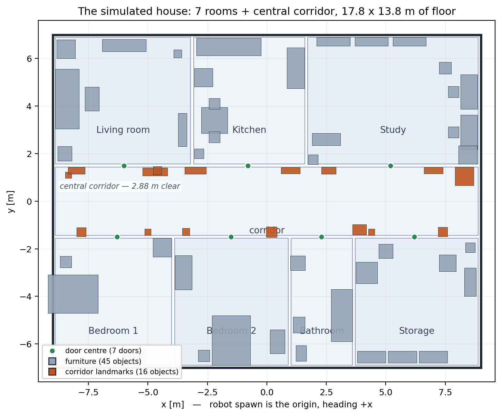

# Lighthouse

**一台自己建图、自己探索、并且听得懂人话的差速移动机器人 —— 跑在 Gazebo Fortress 仿真里。**



> *English: Lighthouse is a differential-drive robot (TurtleBot3 Waffle lineage) that maps a
> seven-room house in Gazebo Fortress with slam_toolbox, navigates it with Nav2, explores the
> parts nobody has mapped yet, and accepts natural-language goals from a local LLM
> ("take me to the kitchen and look at the fridge") — including changing its mind mid-drive.
> Design textbook, 63 pages, English: [`docs/book/lighthouse-textbook.pdf`](docs/book/lighthouse-textbook.pdf).*

世界 18 × 14 m（外墙中心线），7 个房间 + 中央走廊，61 件家具 / 33 类；
车体 0.31 × 0.28 m，单线雷达 360 条射线，相机 320×240 单目（无深度）。

## 能做什么（下面每个数字都是跑出来的）

| 能力 | 实测结果 |
|---|---|
| **巡游建图** | 32 个手标航点全部走完 → 17.9 × 13.9 m 地图，倾斜 +0.0° |
| **自主探索** | 零输入，80 个目标 → 内部未知降到 15.8 m²；覆盖率在约 48 目标处拐平 |
| **语义导航** | 「带我去冰箱」→ 自动选观察位（1.79 m），落点偏差 0.15 m |
| **视觉核验** | qwen3-vl:8b 用 13.1 s 认出冰箱；「前面能过去吗」雷达 1.12 m 与视觉判断一致 |
| **中途改主意** | 7/7 判据通过；被取消的那一段**绝不报"已到达"** |
| **启动断言** | `/scan` 出现第二个发布者，30 s 内被抓出并报警 |
| **验收** | 8 项在线闸门 + 11 项离线检查 + 6 项守卫单测，全绿 |

## 两条建图路线并存

|  | A · 巡游（脚本化航点） | B · 自主探索（前沿探索） |
|---|---|---|
| 输入 | `config/route.json`，32 个手标航点 | 无，自己找 frontier |
| 用时 | 18~19 分钟（实际） | 26 分钟（仿真）/ 45~60 分钟（实际） |
| 换布局要做什么 | 重新标定 32 个航点 | 什么都不用改 |
| 角色 | 阶段一验收产物（图**已冻结**，不再重跑） | 实验平台 |

## 快速开始

ROS 节点必须用**系统 python**（`mak_demo/.venv` 里的 rclpy 是坏的），venv 只跑 agent 侧。

```bash
# 建图 A：巡游（约 7 分钟仿真时间，自动存图）
ros2 launch ./dan_house.launch.py headless:=true slam:=true tour:=true

# 建图 B：自主探索（零输入）
ros2 launch ./dan_house.launch.py headless:=true slam:=true explore:=true

# 导航：用已有地图
ros2 launch ./dan_house.launch.py nav:=true rviz:=true

# 64 线雷达版（地图/参数与单线版互不干扰）
ros2 launch ./dan_house.launch.py lidar:=3d nav:=true loc:=truth
```

离线自检（不需要 ROS、不启仿真、不看屏幕）：

```bash
mak_demo/.venv/bin/python mak_demo/dev/run_offline_checks.py     # → 11/11 通过
```

智能体侧要开 4 个终端（仿真 / rosbridge / agent_bridge / 交互），逐个说明见
[`docs/handbook.md` §18](docs/handbook.md)。

## 仓库结构

```
build_world.py          世界 + 语义真值 + 航点的唯一来源（改房子只改这里）
dan_house.launch.py     唯一入口：把 Gazebo / 桥接 / 投影 / SLAM / Nav2 串起来
models/  worlds/        两套车（单线 / 64 线）与两套世界
config/                 语义地图、32 航点、SLAM 与 Nav2 参数、地图（390 个文件）
mak_demo/               agent 层：意图解析、语义查询、视觉核验、抢占
agent_bridge.py         语言 ↔ ROS 的边界（287 行）
tools/                  /scan 单发布者守卫、探索实验驱动、地图质量解码
experiments/            探索实验的派生指标（原始逐帧转储不入库）
docs/                   教材、PPT、阶段报告、完整手册
delivery/               冻结快照 + SHA-256 清单
```

## 文档

| 想… | 看 |
|---|---|
| **理解设计原理、文件来龙去脉** | [`docs/book/lighthouse-textbook.pdf`](docs/book/lighthouse-textbook.pdf)（63 页，英文） |
| **给别人讲** | [`docs/slides/lighthouse-navigation.pptx`](docs/slides/lighthouse-navigation.pptx)（19 页，英文） |
| **动手跑 / 按症状查踩坑** | [`docs/handbook.md`](docs/handbook.md)（完整手册，含 19 节施工日志） |
| **逐项实测数据** | [`docs/phase2A_results.md`](docs/phase2A_results.md) · [`phase2B_vision.md`](docs/phase2B_vision.md) · [`phase3_lidar3d.md`](docs/phase3_lidar3d.md) |
| **重建文档** | [`docs/README.md`](docs/README.md) |

## 现状与已知缺口

- 仿真侧（建图 / 导航 / 64 线 / 探索 / 抢占）全部达成并验收；**真机没跑过**。
- 定位验收全部用真值位姿 `loc:=truth`；`loc:=amcl` 在真机上从未复验。
- EKF 长跑漂移 7.1 m，未解决 —— 所以导航不依赖轮式里程计。
- 3D 障碍不进 costmap：点云被压成单层切片，悬空横梁与桌面看不见。
- 语义地图是生成器导出的**真值**，不是感知建图（单目相机没有深度，无法把检测框变成地图坐标）。
- 覆盖率天花板 13.5 m² 内部未知，调参调不动（3×3 实验证明净空不是覆盖率旋钮）。

每条缺口的证据与判断见教材第 14 章。

---

## License

**双许可（dual-licensed）：MIT 或 Apache-2.0，任选其一。**

| 文件 | 内容 | 什么时候用它 |
|---|---|---|
| [`LICENSE`](LICENSE) | **双许可声明 + 两份全文合订**（GitHub 识别的就是这份） | 一般情况看这个就够 |
| [`LICENSE-MIT`](LICENSE-MIT) | 单份 MIT 正文 | 想最省事地复用代码 |
| [`LICENSE-APACHE`](LICENSE-APACHE) | 单份 Apache-2.0 正文，附加明确的专利授权条款 | 企业 / 商业环境（法务更认） |

Copyright (c) 2026 Dan (github.com/xiaohai-AI)

第三方归属（TurtleBot3 车身网格、以及不随仓库分发的 Gazebo / ROS 2 / Nav2 /
slam_toolbox / ollama 与所服务的模型）见 [`NOTICE`](NOTICE)：本项目自建的代码、世界、
文档、生成资产适用上述双许可，第三方文件仍从其上游许可证。

